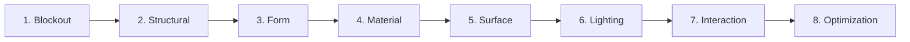

# img2threejs: Code-Only Procedural 3D & Vector Geometry

> `img2threejs` is a design and engineering methodology created to transform visual references into **code-only, procedural Three.js models** and **mathematical vector SVGs**. It completely eliminates heavy external 3D asset downloads (`.gltf`, `.obj`, `.fbx`) and raster textures in favor of lightweight, token-efficient, animation-ready code.

---

## 1. THE 8-PASS STAGED SCULPTING PIPELINE

When reconstructing an object or reference in code, execute in strict sequential stages:



### Pass 1: Blockout
- Establish bounding boxes, reference proportions, overall scale, and origin anchor points.
- Map the object's center of gravity and root pivot.

### Pass 2: Structural Assembly
- Assemble the primary geometric primitives:
  - Cylinders (stems, pillars, battery cells, barrels)
  - Boxes & Extrusions (enclosures, books, chassis, frames)
  - Spheres & Tori (dials, gauges, orbs, rings)
- Group components logically with parent-child relationships (`THREE.Group`).

### Pass 3: Form Refinement & Contours
- Add edge chamfers, fillets, bevels, and curvatures.
- Use `THREE.ExtrudeGeometry` with smooth `THREE.Shape` spline paths for organic contours.
- Ensure silhouette matches the reference from all primary angles (orthographic and perspective).

### Pass 4: Material Architecture
- Avoid image texture files; configure PBR parameters:
  - `roughness` (matte vs glossy)
  - `metalness` (conductive vs dielectric)
  - `clearcoat` and `transmission` (lacquer, glass, amber)
  - `emissive` (status lights, glowing vector accents)

### Pass 5: Procedural Surface Generation
- Generate markings, dials, gradients, and measurement grids directly in memory using HTML5 Canvas textures:
  ```javascript
  function createProceduralDialTexture() {
    const canvas = document.createElement('canvas');
    canvas.width = 512;
    canvas.height = 512;
    const ctx = canvas.getContext('2d');
    // Draw procedural ticks, circular markings, and numbers
    ctx.strokeStyle = '#4DE086';
    ctx.lineWidth = 4;
    ctx.beginPath();
    ctx.arc(256, 256, 200, 0, Math.PI * 2);
    ctx.stroke();
    return new THREE.CanvasTexture(canvas);
  }
  ```

### Pass 6: Lighting Rig
- Build an intentional three-point lighting rig:
  - Key light (warm high-angle directional light)
  - Fill light (cool low-intensity ambient/directional light)
  - Rim light (sharp back-light highlighting object silhouette edges)

### Pass 7: Interaction & Animation Rigging
- Build the model with animation-ready pivot points:
  - Articulated hinges, rotating dials, floating hover loops.
  - Add pointer/touch tracking to give tactile tilt response:
    ```javascript
    group.rotation.y = THREE.MathUtils.lerp(group.rotation.y, targetRotationY, 0.05);
    group.rotation.x = THREE.MathUtils.lerp(group.rotation.x, targetRotationX, 0.05);
    ```

### Pass 8: Optimization & Battery Discipline
- Merge static geometries using `BufferGeometryUtils.mergeGeometries()`.
- Pause render loops when the canvas is off-screen (using `IntersectionObserver`).
- Cap rendering to device pixel ratio `Math.min(window.devicePixelRatio, 2)`.

---

## 2. 2D MATHEMATICAL VECTOR SVG BRIDGE (MOBILE & WIDGET FALLBACK)

For low-power mobile devices, webviews, and compact dashboard widgets where WebGL canvas context creates excessive overhead or battery drain:

1. **Procedural Vector Projection**:
   - Reconstruct the 3D subject as a layered, scalable mathematical SVG.
   - Use isometric or faux-3D perspective with geometric paths and vector gradients.
2. **Infinite DPI & Zero GPU Overhead**:
   - SVGs render at native display sharpness on any screen resolution.
   - Zero memory footprint, 60fps CSS transitions, and instant DOM hydration.
3. **Parametric State Binding**:
   - Directly bind SVG path attributes (stroke-dashoffset, fill, transform) to application state (battery level, reading progress, habit streaks).
