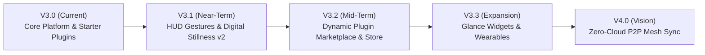

# V07 Sanctuary V3 — Future Plans & Architectural Roadmap

## Executive Overview

V07 Sanctuary V3 reconstructs the application from the ground up as a **sovereign, local-first platform with a first-class plugin engine** ([AGENTS.md](file:///D:/software/V07-Android/AGENTS.md) § 15). 

With the core milestone achieved—featuring the hybrid **Jetpack Compose Sanctuary Shell**, the offline **Ktor Loopback HTTP Engine**, **7 Core System Engines**, and **10 Isolated Modular Plugins**—this document outlines the roadmap, planned capabilities, technical specifications, and architectural evolution for future releases.

---

## Roadmap Timeline & Milestone Summary



| Milestone | Target Horizon | Core Focus | Primary Architectural Deliverables |
| :--- | :--- | :--- | :--- |
| **V3.1** | Near-Term (Next Sprint) | Deep Telemetry & HUD Polish | • Gesture-driven Floating HUD (snap-to-edge, mini-controls)<br>• Hourly screen-time histogram & doom-scroll nudges<br>• SQL Query Cockpit & 30-day Recycle Bin retention |
| **V3.2** | Mid-Term | Plugin Platform Scaling | • Decoupled Plugin Store distribution model ([AGENTS.md](file:///D:/software/V07-Android/AGENTS.md) § 30)<br>• Manifest V2 capability declarations<br>• Inter-plugin event broker (`events:emit` / `events:listen`) |
| **V3.3** | Near-Horizon | Native Android Integrations | • Jetpack Glance Home Screen & Lock Screen widgets<br>• Live Notification Focus timer activities<br>• Health Connect / Body Rhythm sensors bridge |
| **V4.0** | Vision | Absolute Data Sovereignty | • Local P2P Wi-Fi/BLE mesh synchronization<br>• Automated schema migration engine with rollback snapshots<br>• Multi-profile encrypted vault exports |

---

## 1. Near-Term Plans (Milestone V3.1)

### 1.1. Floating Bubble HUD Overlay Evolution ([`V3BubbleOverlayService.kt`](file:///D:/software/V07-Android/app/src/main/java/com/v07/v3/app/overlay/V3BubbleOverlayService.kt))
* **Magnetic Edge Snapping & Physics**:
  * Implement spring-based physics (`SpringAnimation`) snapping the floating pill to the nearest left/right screen margin upon release.
  * Auto-collapse into a subtle translucent edge tab after 5 seconds of inactivity to minimize screen obstruction.
* **Expanded Mini-HUD Controls**:
  * Tap interaction to cycle through:
    1. Active Focus Timer (`25:00` with Play/Pause inline action)
    2. Real-time Foreground App Duration (`Twitter: 18m`)
    3. Daily Screen Time Total (`2h 15m`)
  * Long-press quick capture: Spawns an ephemeral micro-dialog for instant thought capture without switching out of the current third-party app.
* **Double-Tap Action**:
  * Double-tap the floating pill to instantly open the Sanctuary Home Screen or Digital Stillness overview.

### 1.2. Digital Stillness & Screen Time Intelligence ([`ScreenTimeTracker.kt`](file:///D:/software/V07-Android/app/src/main/java/com/v07/v3/app/telemetry/ScreenTimeTracker.kt))
* **Hourly Usage Breakdown**:
  * Add 24-column bar chart in `modal-screentime` representing usage intensity throughout the day.
* **Mindful Doom-Scroll Interventions**:
  * Background telemetry detector triggering a gentle floating notification or vibration when a single entertainment/social package exceeds 20 continuous minutes.
  * Non-judgmental pause suggestions: *"You've been in Reddit for 20m. Breathe in, breathe out, or return to sanctuary."*
* **App Grouping & Whitelist Rules**:
  * User-customizable categorization in Settings: Productivity, Reading, Social, Tools, System.
  * Whitelist option to exempt navigation and meditation apps from stillness limits.

### 1.3. Database Admin Cockpit (`/admin`) & Data Sovereignty
* **Interactive Raw SQL Console**:
  * Secure, authenticated SQL query console inside `/admin` with read-only safeguarding and query latency profiling.
* **Single-Click Database Vacuum & Optimization**:
  * Scheduled automatic WAL (Write-Ahead-Log) checkpointing and database compaction.
* **Recycle Bin Automation**:
  * Automated background pruning of items soft-deleted for more than 30 days.
  * Visual side-by-side JSON/Text diff viewer before executing a recovery operation.

---

## 2. Mid-Term Plans (Milestone V3.2 — Plugin Platform Maturity)

### 2.1. Plugin Distribution & Web Store Engine ([AGENTS.md](file:///D:/software/V07-Android/AGENTS.md) §§ 29, 30, 31)
* **Decoupled Store Contract**:
  * Maintain clean separation between the **Runtime Manifest** (`manifest.json` — permissions, endpoints, assets) and **Store Presentation Metadata** (`store.json` — screenshots, descriptions, publisher verification).
* **Plugin Packs (`.v07pack`)**:
  * Support bundle installations (e.g. *Mindfulness Starter Pack*, *Athlete Suite*, *Scholar Edition*) that resolve dependencies and install atomically.
* **Package Integrity & Signatures**:
  * Cryptographic Ed25519 signature checks on installed ZIP packages to verify author authenticity.

### 2.2. Inter-Plugin Event Architecture
* Documented asynchronous event broker preventing direct state coupling between plugins ([AGENTS.md](file:///D:/software/V07-Android/AGENTS.md) § 24):
  ```text
  Plugin: Running (com.v07.running)
        ↓  events:emit ("workout:completed", { distanceKm: 5.2, timeSec: 1800 })
  Sanctuary Event Router (Local Native Core)
        ↓  events:listen (requires explicit manifest permission)
  Plugin: Gamify (com.v07.gamify) -> Grants +50 XP
  ```

### 2.3. Dynamic Plugin Hot-Reloading
* Support updating and installing plugins from `.zip` without requiring an entire application restart, reloading only the isolated webview viewport.

---

## 3. Native Android Integrations (Milestone V3.3)

### 3.1. Jetpack Glance Home Screen Widgets
* **Focus Stopwatch & Pomodoro Widget**:
  * 2x2 and 4x2 Home Screen widget displaying remaining focus session time with native pause/play buttons.
* **Daily Gita Verse & Reflection Widget**:
  * Minimalist editorial quote card displaying the daily Sanskrit verse and translation on the Android desktop.
* **Digital Stillness Daily Dial Widget**:
  * Circular progress ring showing daily screen boundaries and stillness cadence.

### 3.2. Health Connect & Sensor Integration
* Native bridge hooks to Android **Health Connect**:
  * Body Rhythm & Vitals plugin access to resting heart rate, sleep duration, and daily step counts.
  * Zero cloud sync: health data queried on-demand and persisted strictly in the local SQLite vault.

### 3.3. Notification Shade Live Activity
* Persistent, low-power foreground media/timer notification with dynamic progress bar and quick-actions (*+5 Minutes*, *Pause*, *Complete*).

---

## 4. Long-Term Vision (Milestone V4.0 — Zero-Cloud Sovereignty)

### 4.1. Peer-to-Peer Offline Mesh Sync
* Direct device-to-device synchronization over local Wi-Fi and Bluetooth LE:
  * Phone ↔ Desktop / Tablet synchronization without passing through third-party servers.
  * Conflict-Free Replicated Data Types (CRDTs) for seamless offline merge across multi-device households.

### 4.2. Automated Zero-Loss Schema Migration Engine
* Forward and backward migration scripts (`migrations/vX_to_vY.sql`) bundled into the database manager.
* Pre-migration snapshot creation with automated rollback if any integrity constraint fails during update.

---

## 5. Architectural Non-Negotiables & Commitments

Every future capability must strictly adhere to the established V3 foundation:
1. **Separation of Concerns**: Core platform owns lifecycles, permissions, and native bridges; plugins own feature behaviors and sandboxed UIs ([AGENTS.md](file:///D:/software/V07-Android/AGENTS.md) § 16).
2. **Local Sovereignty First**: No mandatory cloud accounts or external telemetry leaks. All persistent data lives in open formats and local SQLite ([DECISIONS.md](file:///D:/software/V07-Android/docs/v3/DECISIONS.md) ADR-003).
3. **No Slop Design Bar**: Consistent typography (Plus Jakarta Sans, JetBrains Mono, Marcellus), tactile haptics, and zero text breakage across screen densities.
4. **Transparent Decisions**: Major additions to public APIs, permissions, or database schemas require formal Architectural Decision Records (ADRs).
