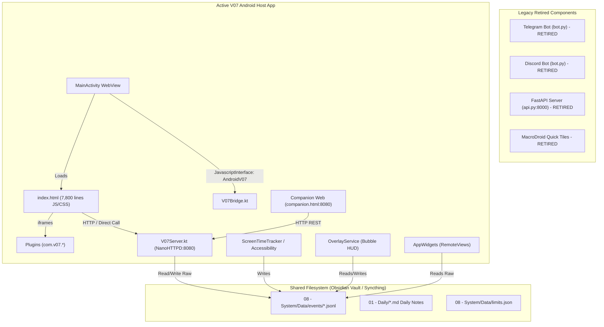

# V3 Architecture Audit: As-Built V1/V2 Systems

## Executive Summary

The V07 ecosystem has evolved across three evolutionary layers:
1. **Layer 1 (V1 Bots)**: Python scripts in an Obsidian vault (`08 - System/Telegram Bot`, `08 - System/Discord Bot`) that parsed chat messages and directly wrote raw strings to append-only `.jsonl` files and markdown daily notes.
2. **Layer 2 (V2 FastAPI / MacroDroid)**: A local Python FastAPI server (`08 - System/REST API`) that exposed REST endpoints for quick Android tile logging via MacroDroid macros.
3. **Layer 3 (V2 Android Standalone)**: An Android app (`D:\software\V07-Android`) packaging an embedded NanoHTTPD/Ktor server (`V07Server.kt`), native background telemetry services (`ScreenTimeTracker.kt`, `V07AccessibilityService.kt`, `V07OverlayService.kt`), native launcher widgets (`V07DashboardWidget.kt`), and a monolithic 7,800+ line single-file web dashboard (`index.html`) loaded inside an Android WebView.

**Critical User Clarification**: External Python scripts and MacroDroid integrations are officially legacy and completely retired for V3. All functionality is consolidated into the standalone V3 system.

---

## 1. Actual System Topology & Architecture

---

## 2. Component Audits

### 2.1 Storage & Data Layer
- **Actual Reality**: Data persistence relies entirely on flat `.jsonl` files (newline-delimited JSON) stored in `08 - System/Data/events/` (e.g. `events.jsonl`, `mood.jsonl`, `energy.jsonl`, `screentime.jsonl`, `running.jsonl`, `sessions.jsonl`, `habits.jsonl`, `hbt.jsonl`, `tasks.jsonl`).
- **Concurrency & Locking**: Zero database locking. Multiple concurrent actors (Android background telemetry service, WebView user interactions, and cloud sync passes) write directly to the same files using standard file-append primitives.
- **Sync Conflicts**: Observed numerous Syncthing conflict files in the vault (e.g. `config.sync-conflict-20260710-111248-7UYT4XH.json`), confirming actual data race occurrences in production.
- **Indexing & Queries**: Zero indexes. To query events for a single day or calculate 7-day aggregates, `V07Server.kt` or `WeeklyAggregator.kt` reads the entire `.jsonl` file into memory, parses every JSON line with `JSONObject`, and filters in a memory loop. As event logs grow past tens of thousands of lines, memory allocations and latency degrade exponentially.
- **Schema Violations**: Field names and types vary wildly across time:
  - Running duration was stored as raw seconds in `duration_min` in some versions, and as formatted strings `"17m"` in others.
  - Habits wrote under category `hbt` in the plugin, but core aggregators queried `habits`.

### 2.2 Backend & HTTP Server Layer
- **Actual Reality**: In the Android app, `V07Server.kt` runs an embedded NanoHTTPD instance on port 8080.
- **Route Handling**: One monolithic class (~1,950 lines) contains massive `if (uri.startsWith(...))` cascades.
- **Security & Network Exposure**:
  - The server binds to `0.0.0.0` or device Wi-Fi interfaces without authentication, CORS protection, or CSRF tokens. Any device on the same local Wi-Fi network can read all user personal vitals, notes, and screen time telemetry, or inject arbitrary events via `POST /api/events`.

### 2.3 Frontend & UI Architecture
- **Actual Reality**: The main client interface is `index.html` in `app/src/main/assets/index.html`.
- **Code Metrics**: A single 7,800+ line file combining HTML, embedded CSS, and over 4,000 lines of procedural JavaScript.
- **State Management**:
  - Entirely ad-hoc global variables (`_events`, `_stData`, `_currentDay`, `_stSessionsData`, `_activeSettingsTab`, `_tempPluginSettings`, etc.).
  - No unidirectional data flow; UI updates occur via manual string concatenation assigned to `element.innerHTML` or direct inline style adjustments.
  - Complex state desynchronization occurs when data is modified in one view (e.g. companion web or widget) while `index.html` is open.
- **Desktop / Companion Duplication**:
  - `companion.html` (1,700+ lines) is a second, standalone copy of the dashboard with duplicated CSS, duplicated event parsers, and duplicated chart drawing code. Bug fixes made to `index.html` frequently fail to reach `companion.html`.

### 2.4 Native Android Integration & Services
- **Native Bridges**: `V07Bridge.kt` exposes native Android APIs to the WebView via `@JavascriptInterface`.
- **Foreground Overlays**: `V07OverlayService.kt` creates a floating system overlay window. Touch event dispatching and window management are tightly coupled with the core application state.
- **Launcher Widgets**: `V07DashboardWidget.kt` uses Android `RemoteViews`. Because `RemoteViews` lacks standard view hierarchies, complex manual string assembly and visibility toggles are applied to simulate multi-module layouts.
- **Background Alarms**: `PluginReminderReceiver.kt` schedules alarms using `AlarmManager`. Prior to recent hotfixes, it used invalid foreign framework drawable resources, causing runtime crashes on API 31+.

---

## 3. Existing Plugin System Audit

### 3.1 What is Actually a Plugin?
In V2, a "plugin" is a directory inside `app/src/main/assets/plugins/` (e.g., `com.v07.tasks`, `com.v07.habits`, `com.v07.vitals`, `com.v07.reader`, `com.v07.timetracker`, `com.v07.gamify`, `com.v07.chronosynth`).
Each directory contains:
- `manifest.json`
- `index.html` (Full-page plugin view)
- `widget.html` (Dashboard card view)
- `settings.html` (Plugin settings modal content)
- `plugin.js` (Optional helper script)

### 3.2 Discovery & Lifecycle
- **Discovery**: `PluginManager.kt` scans the asset folder `plugins/` at startup.
- **Registration**: Reads each `manifest.json` using `JSONObject`. Caches manifest data in memory and writes metadata to `plugins.json`.
- **Lifecycle**: Only two effective states exist: `installed` (present in assets) and `enabled`/`disabled` (stored in a shared preference set). There are no distinct stages for verification, initialization, dependency checking, or runtime teardown.

### 3.3 Communication & Runtime Isolation
- **UI Embedding**: Plugins are loaded directly into `<iframe>` elements inside `index.html`.
- **Isolation Breach**: Plugins access core functions via `window.parent.AndroidV07` or `window.parent.v07OpenPlugin(...)`. There is zero sandbox boundary. Any plugin can manipulate the parent DOM, read parent global variables, or execute native bridge methods.
- **Inter-Plugin Communication**: Unstructured. Plugins communicate by either polluting global `window` objects or by directly writing events into the shared event stream under informal category codes (`hbt`, `gamify`, `read`).

### 3.4 Permissions & Capabilities
- **Declared vs Enforced**: Manifests declare permissions like `["events:read", "events:write", "server", "notification"]`. However, enforcement is purely superficial. In `PluginManager.kt`, built-in plugins bypass checks, and the WebView bridge exposes unrestricted file and server access regardless of declared permissions.

---

## 4. What Works vs What Does Not

### What Works Well
- **High Information Density**: The user can log telemetry in 1–2 seconds.
- **Rich Personal Telemetry Domain**: Uniquely covers cognitive vitals, habits, deep work focus, screen time, athletic endurance, reading, and philosophical reflection.
- **Reliable Android Passive Telemetry**: `UsageStatsManager` combined with `AccessibilityService` reliably tracks foreground app shifts.
- **Instant Local Startup**: Local asset loading in WebView boots instantly with zero cloud roundtrips.

### What Does Not Work / Is Fragile
- **Flat File Concurrency**: Concurrent writes corrupt files or cause Syncthing conflict splits.
- **Query Performance**: Reading entire multi-megabyte JSONL files into memory on every dashboard refresh causes CPU spikes and battery drain.
- **Monolithic Frontend Architecture**: 7,800 lines of procedural JavaScript with manual DOM string concatenation is unmaintainable and prone to silent runtime failures.
- **Fake Plugin Isolation**: Plugins run in un-sandboxed iframes with direct access to parent memory and native bridges.
- **Security Vulnerabilities**: Local HTTP server is unauthenticated on port 8080, exposing all personal health, journal, and telemetry data on local networks.

---

## 5. Architectural Coupling & Technical Debt Inventory

| Problem Area | Manifestation | Risk Level |
| :--- | :--- | :--- |
| **Data Layer** | Unlocked `.jsonl` appends from concurrent background/foreground threads | **CRITICAL** |
| **Code Duplication** | Overlap between `index.html` and `companion.html` | **HIGH** |
| **Global State** | 40+ mutable global variables in `index.html` mutated by dozens of detached functions | **HIGH** |
| **Plugin Leakage** | Plugins invoke `window.parent.AndroidV07` directly; zero memory or API boundary | **HIGH** |
| **Data Parsing** | Parsing raw seconds vs minutes with regex heuristics throughout aggregation classes | **MEDIUM** |
| **Unauthenticated HTTP** | Open NanoHTTPD on 8080 allows arbitrary network reading/writing of personal files | **HIGH** |

---

## 6. What Must NOT Be Carried Into V3

1. **No Flat JSONL as Primary Operational Database**: V3 must use an embedded transactional database (SQLite with WAL mode). Raw JSONL or Markdown should only be an export/sync target, never the operational query engine.
2. **No Monolithic Single-File Web Apps**: `index.html` (7,800 lines) must be replaced with a modular, component-based frontend with clear separation of presentation, state, and domain logic.
3. **No Un-sandboxed Iframe Plugins**: Plugins must interact with core solely via a typed, versioned, asynchronous RPC/messaging bridge (`PluginPlatformAPI`).
4. **No Direct `window.parent` Bridge Access**: Plugins must never have direct handles to host platform bridges or parent window globals.
5. **No Unauthenticated Local HTTP Endpoints**: Any local server or companion endpoint must require session tokens or local loopback authentication.
6. **No External Python Scripts or MacroDroid Dependencies**: Confirmed legacy; deprecated in V3.
