# V3 Information Architecture

## 1. Top-Level Mental Model & Navigation

V3 organizes personal operations into four distinct operational planes:

```mermaid
graph TD
    ROOT["V3 Application Root"]
    
    ROOT --> P1["1. Today & Real-Time Dashboard (Command Surface)"]
    ROOT --> P2["2. Toolkit & Plugin Drawer (Module Surfaces)"]
    ROOT --> P3["3. Synthesis & Retrospectives (Weekly & AI Coaching)"]
    ROOT --> P4["4. Platform Settings & Data Health (System)"]
    
    P1 --> S_CHECKIN["Morning Check-in / Evening Review Flow"]
    P1 --> S_HUD["Header HUD (Date, Level, Streak, Timer)"]
    P1 --> S_GRID["Tactile Micro-Logging Grid"]
    P1 --> S_STREAM["Unified Daily Stream & Timeline"]
    
    P2 --> PLG_HABITS["Habits Matrix"]
    P2 --> PLG_TASKS["Tasks Discipline"]
    P2 --> PLG_FOCUS["Time Tracker / Deep Work"]
    P2 --> PLG_VITALS["Vitals & Neurodynamics"]
    P2 --> PLG_READER["Book Collection & Reading"]
    P2 --> PLG_RUN["Athletics & Fitness"]
    P2 --> PLG_CHRONO["Chronosynth Ambient Audio"]
    
    P3 --> S_WEEKLY["7-Day Multi-Metric Rollup"]
    P3 --> S_AI["Secure AI Copilot Retrospective"]
    P3 --> S_CORR["Correlation Matrix (Mood vs Sleep vs Screen Time)"]
    
    P4 --> S_CONFIG["Plugin Configuration & Permissions"]
    P4 --> S_VAULT["Obsidian Vault Sync Status"]
    P4 --> S_WIDGETS["Home Screen Widget Manager"]
```



---

## 2. Screen & View Hierarchy

### Plane 1: Command Surface (Today / Live Dashboard)
The primary viewport when opening V3 on mobile or desktop:

```text
┌─────────────────────────────────────────────────────────────┐
│ HEADER HUD: [Date] · [Day YR] │ [LVL 5 · XP] │ [Timer Active]│
├─────────────────────────────────────────────────────────────┤
│ DAY RHYTHM CARD: [● CHECKED-IN 08:30] — [Deep Work Target]  │
├─────────────────────────────────────────────────────────────┤
│ 4-STAT GLANCE HUD:                                          │
│ ┌──────────────┬──────────────┬──────────────┬─────────────┐│
│ │ FOCUS 3.2h   │ TASKS 4/6    │ HABITS 5/6   │ SCREEN 2.1h ││
│ └──────────────┴──────────────┴──────────────┴─────────────┘│
├─────────────────────────────────────────────────────────────┤
│ QUICK-LOGGING ACTION TILES:                                 │
│ [⚡ Mood/Energy] [⏱ Focus] [🔥 Habit] [✓ Task] [🏃 Run] [✦ Win] │
├─────────────────────────────────────────────────────────────┤
│ CONTEXTUAL ACTIVE TILES (Plugin Extension Slot):           │
│ ┌─────────────────────────────────────────────────────────┐ │
│ │ HABITS TODAY: [● Morning Med.] [● Code 2h] [○ Reading]   │ │
│ ├─────────────────────────────────────────────────────────┤ │
│ │ TOP PRIORITIES: [HIGH: Architecture Audit & Specs]      │ │
│ └─────────────────────────────────────────────────────────┘ │
├─────────────────────────────────────────────────────────────┤
│ TIMELINE FEED (Chronological event stream with filters)     │
└─────────────────────────────────────────────────────────────┘
  [BOTTOM NAV]: [Today]  [Toolkit]  [Synthesis]  [Settings]
```

### Plane 2: Toolkit & Plugin Drawer (Module Surfaces)
A structured drawer allowing full-screen immersion into any installed module:
- Grid of installed Kit Cards showing real-time module status, health badges, and direct configuration shortcuts (`⚙`).
- Seamless transitions into plugin full-page views (`index.html`) hosted within the secure sandboxed runtime.

### Plane 3: Synthesis & Retrospectives
- **Weekly Multi-Metric Synthesis**:
  - Focus Hours vs Screen Time Ratio.
  - Habit Consistency % across 7 days.
  - Neurodynamics Equilibrium curve (Mood vs Energy balance).
  - Athletic volume (Weekly km and pushup volume).
- **Secure AI Retrospective**:
  - Trigger analysis with chosen AI model (Claude 3.5 Sonnet, Gemini 2.0 Flash, etc.).
  - Output formatted into actionable coaching bullet points: What Went Well, Friction Points, and Next Week Focus.

### Plane 4: System Settings & Platform Administration
- **Plugin Management**: Inspect installed plugins, declared vs granted permissions, update status, and uninstall actions.
- **Home Screen Widgets**: Live vector preview cards with instant module switching (`weekly`, `tasks`, `habits`, `timetracker`, `vitals`, `reader`, `run`).
- **AI Credentials**: Secure local storage of LLM keys with loopback test connection.
- **Obsidian Vault & Backup**: Path selection, sync status, and manual export triggers.

---

## 3. Core User Flows

### Flow 1: Morning Anchor & Check-In (Target: < 10 seconds)
1. Tap notification or open app.
2. Prominent Morning Card: Select initial Mood (1–5) and Energy (1–5).
3. Optional 1-sentence intention note.
4. Tap `[BEGIN DAY]`:
   - Day state transitions to `ACTIVE`.
   - Today's habits and priorities load into live dashboard.
   - Initial XP awarded.

### Flow 2: Micro-Logging During the Day (Target: < 2 seconds)
1. Tap Floating Action Button or Quick-Log Tile.
2. Radial / sheet menu pops up.
3. Tap metric (e.g. `+20 Pushups` or `Habit: Meditation`).
4. Instant haptic tick, optimistic counter updates, toast confirms write.

### Flow 3: Deep Work Focus Session (Target: 1 tap start)
1. Tap `[START FOCUS]` on dashboard or Android Widget.
2. Native foreground service starts; notification shows live stopwatch.
3. Floating overlay bubble displays elapsed time over other apps.
4. Tap `[FINISH]`: prompt for quick session takeaway -> XP calculated -> event logged.

### Flow 4: Evening Review & Check-Out (Target: < 30 seconds)
1. Evening notification at scheduled time (e.g. 21:30).
2. Review today's summary: Total focus hours, habits completed, screen time vs budget.
3. Prompt: "What was your biggest win today?"
4. Tap `[CHECK OUT]`:
   - Day closes.
   - Background projector writes clean Markdown daily note to Obsidian vault.
