# V3 Implementation & Migration Plan

## 1. Incremental Build Strategy

To avoid the perils of a "Big-Bang Rewrite," V3 will be constructed in distinct, independently verifiable increments. At the end of each stage, the codebase must compile cleanly, run on a physical device, and pass automated contract tests.

```mermaid
flowchart LR
    M1["Stage 1: Core Storage & Migration"] --> M2["Stage 2: Native Host & Telemetry"]
    M2 --> M3["Stage 3: Plugin Platform Runtime"]
    M3 --> M4["Stage 4: Modular UI Shell"]
    M4 --> M5["Stage 5: Starter Plugins Porting"]
    M5 --> M6["Stage 6: Android System Integrations"]
    M6 --> M7["Stage 7: AI Gateway & Synthesis"]
    M7 --> M8["Stage 8: Hardening & Cutover"]
```

---

## 2. Detailed Milestone Roadmap

### Stage 1: Core Foundation & Data Engine (COMPLETED)
- **Objective**: Establish the high-performance SQLite WAL storage engine and legacy data migration pipeline.
- **Deliverables Completed**:
  - `V07Database.kt`: Public shared storage SQLite database (`/storage/emulated/0/V07Data/v07.db` with fallbacks) accessible without root. Schemas for 4 Core Modules (`sessions`, `tasks`, `thoughts`, `app_usage`), 3 Core Utilities (`day_tracker`, `recycle_bin`), and isolated `plugin_storage`.
  - `Models.kt`: Strongly typed Kotlin data models.
  - `EventRepository.kt`: Thread-safe ACID repository methods with soft-delete and recycle bin recovery.
  - `DatabaseManager.kt`: Admin utility for VACUUM, table stats, and root-free snapshot backups (`backups/`).
  - `LegacyDataImporter.kt`: Selective sanitizer importing sessions, tasks, thoughts, milestones, and routing habits/running/vitals into `plugin_storage`, while permanently blacklisting and discarding chess/DSA/junk.
- **Verification**: Clean compilation with zero warnings; database resolves without root.

### Stage 2: Native Platform Host & Telemetry Engine (COMPLETED)
- **Objective**: Implement battery-efficient background telemetry and session management.
- **Deliverables Completed**:
  - `ScreenTimeTracker.kt`: Native `UsageStatsManager` passive telemetry engine logging directly into SQLite with app label caching and zero file I/O.
  - `FocusTimerService.kt` & `TimerManager.kt`: Persistent foreground service with crash recovery, ongoing stopwatch/countdown notification, and quick action controls.
  - `LoopbackServer.kt` & `ApiRouter.kt`: Authenticated loopback HTTP server bound to `127.0.0.1` on port 8000 (fallback 8008, 8080) with session token verification, handling REST endpoints for all core modules, utilities, and plugin storage.
  - `V3PlatformHost.kt`: Central lifecycle coordinator.
  - Registered `FocusTimerService` in `AndroidManifest.xml`.
- **Verification**: Verified compilation; passes token authentication.

### Stage 3: Plugin Platform & Sandbox Runtime (COMPLETED)
- **Objective**: Deliver the sandboxed plugin execution engine and capability validator.
- **Deliverables Completed**:
  - `PluginManifest.kt`: Resilient parser and validator supporting both modern V3 and legacy plugin schemas.
  - `PluginRegistry.kt`: Discovery and lifecycle state machine (`DISCOVERED` -> `VALIDATED` -> `INSTALLED` -> `ENABLED` / `DISABLED`) for built-in assets and external storage plugins.
  - `PlatformJsBridge.kt`: Secure `@JavascriptInterface` bridge enforcing permissions (`storage:isolated`, `telemetry:read`, `events:listen`, `events:emit`) and injecting the typed `window.V07Platform` client API.
- **Verification**: Verified compilation; bridge script injected cleanly into WebView.

### Stage 4: Modular Web UI Shell & Day Tracker Timeline (COMPLETED)
- **Objective**: Build the componentized, responsive frontend shell shared across mobile and desktop, featuring the complete Day Tracker Daily Timeline equivalent to V2.
- **Deliverables Completed**:
  - `assets/v3/shell.css`: Design system tokens (tactile vector art variables, fonts, colors, spacing) conforming strictly to `DESIGN_SYSTEM.md`, plus full timeline stream, ribbon cards, and avionic badges.
  - `assets/v3/index.html`: Responsive SPA shell with 4 Core Modules (Focus Timer, Tasks Discipline, Thoughts & Reflections, Screen Time Telemetry), 3 Core Utilities (Day Tracker / Daily Timeline with date navigation `◀` `[ YYYY-MM-DD ]` `▶` `TODAY`, Recycle Bin, Database Manager), and Sandboxed Plugin Host.
  - `assets/v3/shell.js`: Complete SPA client controller communicating with native services and REST endpoints (`/api/v3/*`), including dynamic timeline streaming, day-by-day navigation, and quick milestone creation.
  - `V3Activity.kt`: Hardware-accelerated full-screen WebView Activity with native `V3NativeBridge` RPC injection and dark avionic system bars.
  - Registered `V3Activity` in `AndroidManifest.xml`.
- **Verification**: Full release APK built successfully (`app-release.apk`, 13.55 MB). Clean compilation with zero build errors.

### Stage 5: Port Starter Pack Plugins
- **Objective**: Migrate the 7 core built-in plugins to the V3 specification one by one:
  1. `com.v07.habits` (Habits Matrix)
  2. `com.v07.tasks` (Task Discipline)
  3. `com.v07.timetracker` (Focus Timer)
  4. `com.v07.vitals` (Neurodynamics & Vitals)
  5. `com.v07.reader` (Book Collection)
  6. `com.v07.gamify` (XP & Progression)
  7. `com.v07.chronosynth` (Ambient Audio)
- **Deliverables**: Clean `manifest.json`, `widget.html`, and `index.html` for each plugin utilizing `V07Platform` APIs.
- **Verification**: Each plugin tested independently in the standalone test harness.

### Stage 6: Android System Integrations
- **Objective**: Ambient glanceability and native OS touchpoints.
- **Deliverables**:
  - Declarative Android Home Screen AppWidgets supporting instant module switching.
  - Native Android Quick Settings Tiles (`TileService`) for 1-tap logging directly from the notification shade.
  - Optional floating overlay bubble service.
- **Verification**: Widgets update smoothly across module toggles; Quick Settings tiles execute without launching the main app.

### Stage 7: Local AI Gateway & Multi-Metric Synthesis
- **Objective**: Secure, cached AI coaching and 7-day multi-metric analysis.
- **Deliverables**:
  - Server-side AI gateway supporting Anthropic Claude, Google Gemini, and OpenAI models.
  - Weekly multi-metric rollup engine (Focus vs Screen Time, Habit Consistency %, Equilibrium curve).
  - Prompt templates with response caching and structured JSON output parsing.
- **Verification**: Generate a complete weekly retrospective with mocked and live LLM keys; verify token usage and response rendering.

### Stage 8: System Verification, Final Cutover & Debt Audit
- **Objective**: Final quality gate and release packaging.
- **Deliverables**:
  - Full end-to-end user journey tests (Morning checkin -> Day logging -> Focus session -> Evening checkout).
  - Final architecture review document (`docs/v3/FINAL_ARCHITECTURE_REVIEW.md`).
  - Production release APK compilation.
- **Verification**: App boots in < 500ms, consumes < 40MB RAM, and operates completely offline.
