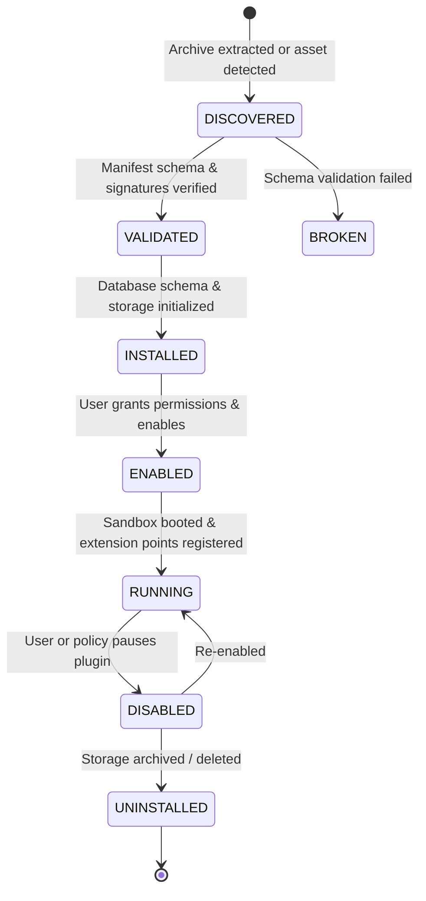

# V3 Plugin Platform Specification

## 1. Core Principle & Architecture

V3 is fundamentally a plugin platform. Built-in plugins (`tasks`, `habits`, `vitals`, `timetracker`, `gamify`, `reader`, `chronosynth`) represent the **starter pack** and conform to the exact same contract, manifest schema, and permission rules as future third-party plugins.

```text
               V3 Plugin Contract
                /              \
               /                \
   Built-in Starter Pack    Future Store / Community Plugins
```

---

## 2. Plugin Identity & Manifest Schema

### Identity Rules
- Every plugin must have a stable unique identifier formatted as a reverse domain name: `com.<publisher>.<plugin-id>` (e.g., `com.v07.habits`).
- The ID must remain immutable across version updates, folder renames, or display title changes.

### Machine-Readable Manifest (`manifest.json`)
Every plugin package must include a root `manifest.json` conforming to this JSON Schema:

```json
{
  "$schema": "https://v07.app/schemas/v3/plugin-manifest.json",
  "id": "com.v07.habits",
  "name": "Habits Matrix",
  "version": "3.0.0",
  "apiVersion": "3.0",
  "description": "Daily recurring consistency checklist and streak tracker.",
  "publisher": {
    "name": "V07 Core Team",
    "url": "https://v07.app"
  },
  "permissions": [
    "storage:isolated",
    "events:listen",
    "notifications:schedule"
  ],
  "capabilities": [
    "ui:widget",
    "ui:kitTile",
    "ui:page"
  ],
  "dependencies": {
    "v07-platform": ">=3.0.0"
  },
  "extensionPoints": {
    "widgets": [
      {
        "id": "habits_matrix_card",
        "title": "HABITS MATRIX",
        "entry": "widget.html",
        "supportedSizes": ["compact", "small", "medium", "large"],
        "defaultSize": "medium"
      }
    ],
    "kitTile": {
      "label": "HABITS",
      "icon": "check_circle",
      "color": "#4DE086"
    },
    "page": {
      "entry": "index.html",
      "title": "Habits Matrix"
    },
    "settings": {
      "schema": "settings.schema.json"
    }
  },
  "config": {
    "dailyReminderTime": {
      "type": "string",
      "format": "time",
      "default": "08:30",
      "description": "Daily notification time to complete habits"
    }
  }
}
```

---

## 3. Predictable Lifecycle State Machine

A plugin transitions deterministically through 7 distinct lifecycle states:



1. **DISCOVERED**: The host detects a plugin package in local storage or built-in assets.
2. **VALIDATED**: The manifest schema, required API version, and dependencies are verified. Missing or circular dependencies reject activation.
3. **INSTALLED**: The core allocates an isolated SQLite storage namespace for the plugin.
4. **ENABLED**: The user grants requested permissions; the plugin is marked active.
5. **RUNNING**: The plugin script runs inside the sandbox; UI widgets and kit tiles are registered into the host shell.
6. **DISABLED**: The plugin execution is suspended; widgets are unmounted from dashboards. Storage is preserved.
7. **UNINSTALLED**: Extension points are unregistered; user is prompted whether to purge or archive isolated storage.

---

## 4. Permission & Security Boundary

Permissions must be explicitly declared and user-granted:

| Permission | Description |
| :--- | :--- |
| `storage:isolated` | Read and write to the plugin's own isolated key-value/SQLite namespace. |
| `events:listen` | Subscribe to platform domain events (e.g. `day:start`, `session:stop`). |
| `events:emit` | Emit custom typed events onto the platform event bus. |
| `notifications:schedule` | Schedule local alarm reminders via the host platform. |
| `network:fetch` | Make outbound HTTP requests to user-whitelisted external URLs. |

Unrequested permissions are strictly blocked by the runtime proxy. Plugins have **zero direct access** to host device sensors, telephony, or root filesystems.
