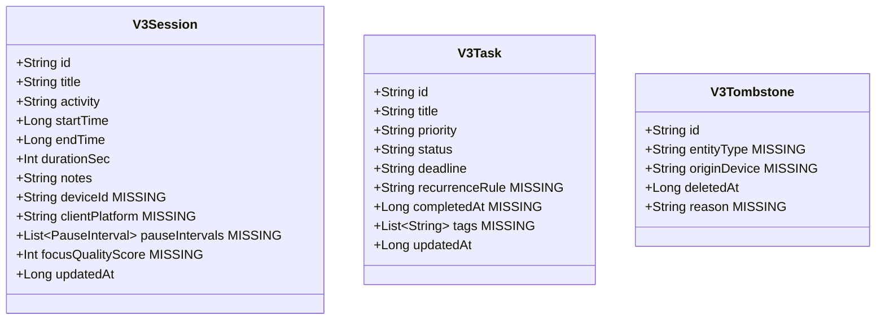
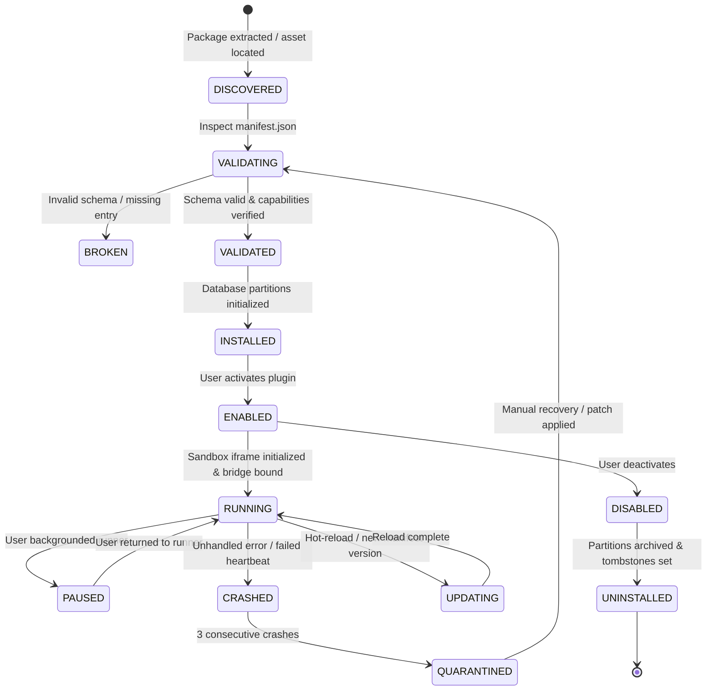
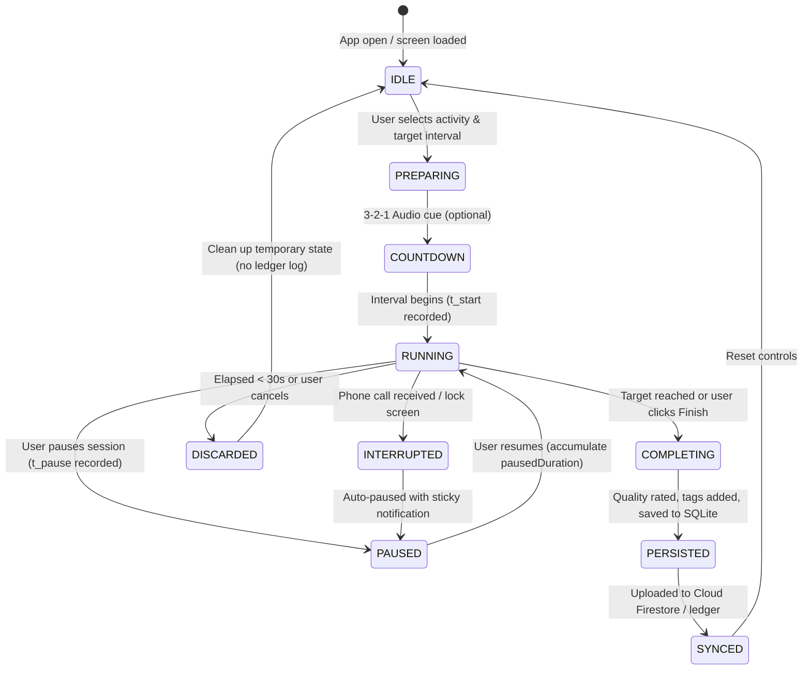
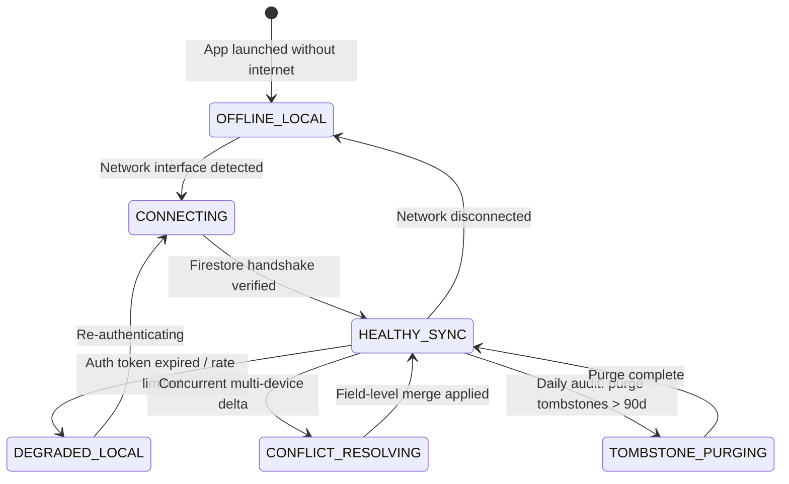
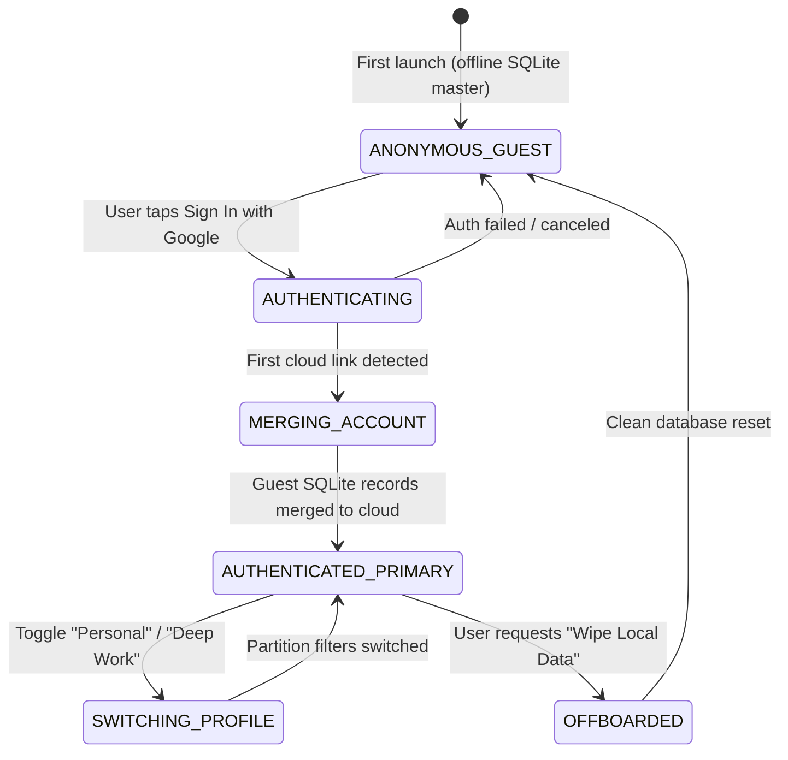

# V07 V3: System Requirements Document (SRD)
## Comprehensive Technical Specification, Flaw Scrutiny, Missing States Matrix & Target Improvements

> **Document Status**: Normative Architecture Specification  
> **Release Target**: V07 V3.0 (Calm Digital Sanctuary)  
> **Ecosystem Scope**: Web Companion + Android Native App + Plugins Platform + Session Engine + Profiles & Identity  
> **Last Updated**: 2026-10-02  

---

## Table of Contents
1. [Executive Vision & Ecosystem Topology](#1-executive-vision--ecosystem-topology)
2. [Architectural Scrutiny: Flaws, Lapses & Antipatterns](#2-architectural-scrutiny-flaws-lapses--antipatterns)
3. [UI Flow Scrutiny & Interaction Lapses](#3-ui-flow-scrutiny--interaction-lapses)
4. [Hardcoded & Missing Data Catalog](#4-hardcoded--missing-data-catalog)
5. [Security Vulnerability Audit & Threat Modeling](#5-security-vulnerability-audit--threat-modeling)
6. [The Missing States Matrix](#6-the-missing-states-matrix)
7. [Subsystem 1: Web Companion Requirements (PWA/SPA)](#7-subsystem-1-web-companion-requirements-pwaspa)
8. [Subsystem 2: Android Native App & Host Requirements](#8-subsystem-2-android-native-app--host-requirements)
9. [Subsystem 3: Plugins Platform & Sandbox Requirements](#9-subsystem-3-plugins-platform--sandbox-requirements)
10. [Subsystem 4: Session Management & Chronometer Requirements](#10-subsystem-4-session-management--chronometer-requirements)
11. [Subsystem 5: Profiles, Identity & Multi-Device Sync Requirements](#11-subsystem-5-profiles-identity--multi-device-sync-requirements)
12. [Interface Protocols & IPC Bridges Matrix](#12-interface-protocols--ipc-bridges-matrix)
13. [Data Persistence, Schemas & Tombstone Specifications](#13-data-persistence-schemas--tombstone-specifications)
14. [Quality Bar, Verification & Impeccable Laws](#14-quality-bar-verification--impeccable-laws)

---

## 1. Executive Vision & Ecosystem Topology

### 1.1 Product Mission
**V07 V3** is a calm, distraction-free reconstruction of personal life-logging, contemplation, and deep focus. In contrast to hyperactive enterprise productivity software, noisy notification feeds, or neon avionics dashboards, V07 V3 is built on the tactile metaphor of a **finely bound personal notebook**: *Warm Paper* in daylight and *Night Ink* after sunset.

The platform unifies:
- Quiet daily reflections and journaling with zero algorithmic feeds
- Contemplative reading journeys (Kindle & physical shelf sync)
- Mindful daily rituals and habits with zero guilt-tripping streaks
- Uninterrupted intervals for deep work and present focus
- Digital stillness with serene pace trajectories
- Timeless wisdom contemplation (Bhagavad Gita daily shlokas)
- 100% data sovereignty via local-first storage and transparent sync

### 1.2 5-Pillar Architecture Topology

```mermaid
flowchart TB
    subgraph Client_Web ["1. Web Companion (PWA / Cockpit)"]
        WC_SHELL["Companion Shell (SPA)"]
        WC_STORAGE["V07StorageEngine (Dual Cache)"]
        WC_VIEWS["Cockpit / Habits / Chrono / Journal"]
        WC_SANDBOX["Plugin Sandbox Runner (iframe)"]
        WC_SHELL --> WC_VIEWS & WC_SANDBOX
        WC_VIEWS --> WC_STORAGE
    end

    subgraph Client_Android ["2. Android Native Host (Handheld Master)"]
        ACT["V3Activity (WebView Shell)"]
        LOOPBACK["Loopback HTTP (127.0.0.1)"]
        TIMER_SVC["FocusTimerForegroundService"]
        USAGE_SVC["AppUsageCollectorService"]
        SQL_DB[("SQLite WAL Database (v07_phone.db)")]
        ACT --> LOOPBACK & SQL_DB
        TIMER_SVC & USAGE_SVC --> SQL_DB
    end

    subgraph Plugins_Engine ["3. Plugins Platform (Isolated Extensions)"]
        PLG_HABITS["com.v07.habits"]
        PLG_TASKS["com.v07.tasks"]
        PLG_CHRONO["com.v07.timetracker"]
        PLG_VITALS["com.v07.vitals"]
        PLG_GITA["com.v07.gita"]
        PLG_DYNAMIC["Future Dynamic / Store Plugins"]
    end

    subgraph Cloud_Tier ["5. Cloud Sync & Profile Partitioning"]
        FB_AUTH["Firebase Auth (Google / Email)"]
        FS_CORE["Tier 1: Core Collections (/sessions, /tasks, /thoughts)"]
        FS_PLUGINS["Tier 2: Plugin Partitions (/plugins/{id}/events, /storage)"]
        FS_LEDGER["Tier 3: Sovereign Ledger & Tombstones (/ledger, /tombstones)"]
    end

    WC_STORAGE <-->|Firestore Live Snapshots| FS_CORE & FS_PLUGINS & FS_LEDGER
    ACT <-->|V3CompanionSyncManager| FS_CORE & FS_PLUGINS & FS_LEDGER
    WC_SHELL <-->|window.V07 Bridge RPC| Plugins_Engine
    ACT <-->|AndroidBridge / Web Message| Plugins_Engine
    WC_STORAGE -.->|Local Loopback RPC (X-V07-Token)| LOOPBACK
```

---

## 2. Architectural Scrutiny: Flaws, Lapses & Antipatterns

A thorough architectural audit of the existing codebase (`D:\companion-site` and `D:\software\V07-Android`) reveals critical design lapses that must be resolved in V3.

### Flaw 2.1: Web Companion Timer Drift & In-Memory Volatility
- **Current Behavior**: In `index.html`, the focus chronometer (`_chrono`) runs inside a JavaScript `setInterval` executing every 1,000ms and incrementing `_chrono.seconds++`.
- **Architectural Lapse**: Modern browsers (Chrome, Edge, Safari) aggressively throttle background tab timers to 1 tick per minute. If a user starts a 50-minute deep work session and switches to an IDE or document, the timer advances only ~50 seconds in 50 real minutes. Furthermore, `_chrono` is held purely in volatile RAM; an accidental reload cancels the entire session.
- **V3 Requirement**:
  1. The chronometer must calculate elapsed time using monotonic timestamps:  
     $$\Delta t = \text{now}() - t_{\text{start}} - \Delta t_{\text{paused}}$$
  2. State must persist in `sessionStorage` with cross-tab synchronisation via `BroadcastChannel`.

### Flaw 2.2: Hardcoded Personal UID Antipattern
- **Current Behavior**: In `V3CompanionSyncManager.kt` (line 43):
  ```kotlin
  const val DEFAULT_COMPANION_UID = "5fwVgpra4pRzB1QqMWb9LSZSqrp2"
  ```
- **Architectural Lapse**: Multi-tenancy and data isolation are completely broken. If a new user installs the Android APK and runs it without signing in to Google, all local SQLite records are uploaded to, and downloaded from, the developer's personal cloud partition.
- **V3 Requirement**:
  1. Complete removal of hardcoded UIDs.
  2. Strict isolation: Unauthenticated sessions must run in **Offline Guest Mode** backed exclusively by a randomly generated local device UUID (`UUID.randomUUID()`). Cloud sync must remain disabled until explicit user authentication.

### Flaw 2.3: Cross-Device Session Disconnect
- **Current Behavior**: Android runs `FocusTimerService` with a sticky foreground notification. The Web Companion runs `_chrono` in JavaScript.
- **Architectural Lapse**: The two runtimes have zero live coordination. Starting a session on mobile leaves the desktop dashboard unaware. The web app cannot trigger the mobile phone's foreground service or app-blocking overlays.
- **V3 Requirement**:
  1. Real-time active session presence in Firestore: `users/{uid}/system/active_session`.
  2. Bi-directional state reflection: When mobile starts a session, the Web Companion displays the live countdown with a "Linked Handheld Active" badge.

### Flaw 2.4: Monolithic Web Companion File Architecture
- **Current Behavior**: `D:\companion-site\index.html` is a monolithic file exceeding 6,600 lines containing embedded Tailwind classes, HTML templates, CSS custom properties, SVG paths, database managers, chart pipelines, and business logic.
- **Architectural Lapse**: Violates Single Responsibility and Clean Architecture principles. Testing individual modules, auditing security boundaries, and managing state transitions is fragile and error-prone.
- **V3 Requirement**:
  1. Modular component architecture separating Presentation, State Management (`V07StorageEngine`), Plugin Host Bridge (`window.V07`), and Domain Controllers into decoupled JavaScript modules.

### Flaw 2.5: Plugin Sandbox Fragility & Missing Heartbeat
- **Current Behavior**: Plugins run in an `<iframe>` sandbox and communicate through `window.parent` or `postMessage`.
- **Architectural Lapse**: There is no RPC handshake, no protocol versioning, and no watchdog timer. If an untrusted or buggy plugin triggers an infinite JavaScript loop or unhandled promise rejection, the host runner freezes with no graceful recovery option.
- **V3 Requirement**:
  1. Host-to-plugin watchdog ping (`v07:ping` / `v07:pong`) every 5,000ms.
  2. Automatic crash boundary fallback displaying a "Plugin Terminated - Reload or Quarantine" dialog.

### Flaw 2.6: Unbounded In-Memory Data Collections
- **Current Behavior**: `_eventsCache` loads all historical records into a single flat array.
- **Architectural Lapse**: As user history grows over years (>10,000 records), evaluating `.filter(e => isHabitCategory(e.category))` on every date change or keypress degrades frame rates and triggers garbage collection spikes.
- **V3 Requirement**:
  1. Windowed temporal caching: Querying only active date range ($T \pm 30\text{ days}$) by default.
  2. Indexed lookup maps for $O(1)$ habit check-in and streak evaluation.

---

## 3. UI Flow Scrutiny & Interaction Lapses

| UI Subsystem | Current Implementation Lapse | Critical Consequence | V3 Specification Improvement |
|---|---|---|---|
| **Cockpit / Dashboard** | Missing network offline indicator | User assumes data is cloud-synced when operating offline; risks data confusion | Top-bar status badge: `Cloud Synced` (emerald) vs `Local Sanctuary (Offline)` (amber) with uncommitted mutation counter |
| **Focus Chronometer** | No audible or push alert on completion | User working in another tab or physical notebook misses the end of focus interval | Web Audio API calm bell chime + Web Notifications API prompt upon timer expiration |
| **Focus Chronometer** | No session cancellation confirmation | Accidental tap on "Reset" immediately erases active flow progress | Modal prompt: *"Release this focus interval? Unsaved progress will be discarded."* |
| **Focus Chronometer** | Abrupt session completion | Saves generic string without quality reflection | Post-session modal: Assign tags (`#writing`, `#coding`), rate presence (1-5 ⭐), and write a reflection note |
| **Habits Cadence** | No inline habit editing | User cannot rename a habit or update its icon after creation | Tap-and-hold or edit icon opens Habit Settings modal (Title, Icon picker, Color swatch, Cadence frequency) |
| **Habits Cadence** | Single-date check-in limitation | Checking off yesterday's habit requires changing global date selector | Matrix view supports direct clicking on any day in the past 7 days to toggle check-in |
| **Obligations (Tasks)** | No task editing modal | Clicking a task only toggles completion; cannot update deadline or priority | Double-click or swipe opens Task Edit sheet (Title, Priority, Due Date, Recurrence) |
| **Obligations (Tasks)** | No delete confirmation | Immediate deletion without undo safety net | Non-destructive soft-delete with 5-second "Undo" snackbar + quarantine in Recycle Bin |
| **Journal / Thoughts** | Unformatted plain-text display | Rich Markdown thoughts render as raw unstyled strings | Markdown typography renderer (headers, italics, bold, checklists, blockquotes) |
| **Plugin Hub** | No capability consent modal | Third-party or dynamic plugins load without explicit user permission review | Pre-launch permissions modal listing requested access (`storage`, `notifications`, `events`) with Allow/Deny controls |
| **Plugin Hub** | No keyboard escape in runner | User trapped in full-screen iframe on desktop; must locate small cross icon | Global `Escape` key listener closes the active sandbox runner and returns to Dashboard |
| **Sovereign Vault** | Blind JSON import without validation | Corrupted or malicious JSON crashes the storage engine | Pre-import validation pipeline: JSON Schema check, entity count diff preview, and rollback snapshot |

---

## 4. Hardcoded & Missing Data Catalog

### 4.1 Exhaustive Catalog of Hardcoded Data Artifacts

| Component | File & Location | Hardcoded Value | Defect Description |
|---|---|---|---|
| **Cloud Sync** | `V3CompanionSyncManager.kt:43` | `"5fwVgpra4pRzB1QqMWb9LSZSqrp2"` | Personal UID hardcoded as global fallback; breaches multi-tenancy |
| **Analytics Engine** | `index.html:5855` | `var activeHabitsCount = 3;` | Hardcoded denominator in adherence calculation; breaks when user tracks 11 canonical habits |
| **Gamification** | `index.html:5566-5580` | HTML strings: `"Deep Work Focus (+50 XP)"`, `"Triple Obligation (+45 XP)"` | Quests are completely static HTML with zero dynamic binding to actual user events |
| **Gita Fallback** | `index.html:4445-4447` | `sanskrit.innerHTML = '????????...'` | Corrupted Unicode question marks resulting from encoding mismatch during file transfer |
| **Loopback Server** | `LoopbackServer.kt:40` | `listOf(8000, 8008, 8080, 8888)` | Static port candidate list without dynamic OS port discovery (`ServerSocket(0)`) |
| **Companion Auth** | `index.html:2127-2134` | Static Firebase JSON config block | Static client configuration prevents custom deployment to self-hosted or staging Firebase projects |

### 4.2 Missing Telemetry & Schema Fields



---

## 5. Security Vulnerability Audit & Threat Modeling

### 5.1 Threat Matrix & CWE Classifications

```text
[THREAT 1: CRITICAL] Localhost Cross-Origin Exfiltration (CWE-346 / CWE-942)
  ├── Location: app/src/main/java/com/v07/v3/app/server/LoopbackServer.kt & ApiRouter.kt
  ├── Flaw: LoopbackServer writes "Access-Control-Allow-Origin: *" on all responses.
  │         ApiRouter only validates "X-V07-Token" on POST, PUT, DELETE requests.
  │         GET requests (/api/v3/thoughts, /api/v3/sessions, /api/v3/entries) require NO token.
  ├── Attack Vector: Any website visited by the user in Google Chrome can run:
  │                  fetch("http://127.0.0.1:8000/api/v3/thoughts")
  │                  and silently exfiltrate the user's private journals and focus sessions!
  └── Remediation: 1. Enforce X-V07-Token on ALL HTTP verbs (including GET).
                   2. Replace "Access-Control-Allow-Origin: *" with strict origin reflection
                      only for verified origins (https://v07-dashboard.web.app).

[THREAT 2: HIGH] DOM-Based Cross-Site Scripting via innerHTML (CWE-79)
  ├── Location: index.html (renderPluginsView, renderTimelineView, renderDirectives)
  ├── Flaw: External string payloads (plugin manifest descriptions, event notes) concatenated
  │         directly into innerHTML strings without entity sanitization.
  ├── Attack Vector: A malicious third-party plugin manifest or shared note containing:
  │                  
  │                  executes in the context of the companion domain.
  └── Remediation: 1. Implement mandatory esc() escaping on all interpolations.
                   2. Enforce strict Content Security Policy (CSP) blocking inline script evaluation.

[THREAT 3: HIGH] Unvalidated Window postMessage Ingestion (CWE-345)
  ├── Location: index.html & plugin.js
  ├── Flaw: window.addEventListener("message", fn) receives payloads without checking ev.origin.
  ├── Attack Vector: Any embedded iframe or popup can send spoofed data mutations:
  │                  window.postMessage({ type: "v07_write_event", data: {...} }, "*")
  └── Remediation: Strictly assert ev.origin === expectedSandboxOrigin before processing.

[THREAT 4: MEDIUM] Plaintext Credential Persistence in LocalStorage (CWE-922)
  ├── Location: index.html
  ├── Flaw: Firebase auth tokens and custom session secrets stored in unencrypted browser localStorage.
  └── Remediation: Android host stores secrets in EncryptedSharedPreferences (AES-256-GCM);
                   Web Companion relies on Firebase Auth's standard indexedDB security boundary.

[THREAT 5: MEDIUM] Concurrent Offline Sync Race Conditions (CWE-362)
  ├── Location: V3CompanionSyncManager.kt & V07StorageEngine
  ├── Flaw: "Last Write Wins" resolution relies on local device wall-clock timestamps.
  │         Clock skew between mobile and laptop silently overwrites contemporary edits.
  └── Remediation: Implement Lamport Logical Clocks or field-level update reconciliation.
```

---

## 6. The Missing States Matrix

To ensure deterministic system behavior under all network, runtime, and user conditions, the following state machines must be explicitly implemented.

### 6.1 Plugin Lifecycle State Machine



### 6.2 Focus Session Chronometer State Machine



### 6.3 Network & Cloud Sync State Machine



### 6.4 Profile & User Identity State Machine



---

## 7. Subsystem 1: Web Companion Requirements (PWA/SPA)

### 7.1 Runtime & Deployment Target
- **Hosting**: Firebase Hosting (`https://v07-dashboard.web.app`) with static distribution.
- **PWA Capabilities**: W3C Web App Manifest, ServiceWorker offline caching of static shell assets (`index.html`, CSS, icons).
- **Responsive Viewport Breakpoints**:
  - `Compact (Mobile)`: $< 640\text{px}$ (Stacked cards, bottom navigation dock, compact 1-column matrix).
  - `Split (Tablet)`: $641\text{px} - 1024\text{px}$ (2-column layout, drawer navigation).
  - `Cockpit (Desktop)`: $\ge 1025\text{px}$ (Multi-column dashboard, side-by-side chronometer, expanded 140-day activity heatmap).

### 7.2 Core Views Specification
1. **Sanctuary Cockpit (Dashboard)**:
   - Primary KPI Pills: Active Focus Time today, Pending Obligations, Habit Consistency Ratio, Screen Time Telemetry, Current Rank Badge.
   - Sovereign Activity Spine: Chronological timeline stream of the selected date.
2. **Habit Cadence Matrix**:
   - Single-source canonical habit list (11 canonical habits + user custom habits).
   - 140-Day Activity Heatmap (20 weeks $\times$ 7 days) displaying daily completion density.
   - One-tap toggle check-ins updating canonical records without duplicate generation.
3. **Focus Chronometer**:
   - Monotonic countdown / stopwatch chronometer with circular SVG progress track.
   - Audible bell chimes and Web Notifications API integration.
4. **Data Management & Migration Console**:
   - Partitioned Firestore migration auditor with live checksum verification.
   - Sovereign Vault JSON export and schema-validated import.

---

## 8. Subsystem 2: Android Native App & Host Requirements

### 8.1 Runtime Environment
- **Minimum SDK**: Android 8.0 (API Level 26 - `Oreo`).
- **Target SDK**: Android 14/15 (API Levels 34/35).
- **Architecture**: Single-Activity Architecture (`V3Activity`) hosting an optimized hardware-accelerated `WebView`.

### 8.2 Native Host Services
1. **Loopback HTTP Server (`LoopbackServer.kt`)**:
   - Binds strictly to loopback interface `127.0.0.1`.
   - Requires dynamic free port binding (`ServerSocket(0)`) or fallback ports (8000, 8008, 8080, 8888).
   - **Security Mandatory**: Authenticates **ALL** HTTP methods (including `GET`) with header `X-V07-Token`.
2. **Focus Timer Foreground Service (`FocusTimerService.kt`)**:
   - Promoted to Android Foreground Service with sticky ongoing notification.
   - Notification Actions: Pause, Resume, Stop, and +5m quick extend.
   - Holds a partial `WakeLock` to prevent CPU sleep during active countdowns.
3. **App Usage Telemetry Service (`ScreenTimeTracker.kt`)**:
   - Interrogates `UsageStatsManager` every 15 minutes.
   - Aggregates foreground package durations and normalizes to digital vitals categories (`Work`, `Social`, `Entertainment`, `Utilities`).

---

## 9. Subsystem 3: Plugins Platform & Sandbox Requirements

### 9.1 Identity & Manifest Specification
- **ID Format**: Reverse-DNS string: `com.<publisher>.<plugin-id>` (e.g., `com.v07.habits`).
- **Manifest Schema (`manifest.json`)**:
  ```json
  {
    "$schema": "https://v07.app/schemas/v3/plugin-manifest.json",
    "id": "com.v07.habits",
    "name": "Habits Matrix",
    "version": "3.0.0",
    "apiVersion": "3.0",
    "publisher": { "name": "V07 Core Team" },
    "permissions": ["storage:isolated", "events:read", "events:write"],
    "capabilities": ["ui:widget", "ui:page"],
    "extensionPoints": {
      "widgets": [{ "id": "matrix", "entry": "widget.html", "supportedSizes": ["small", "medium", "large"] }],
      "page": { "entry": "index.html", "title": "Habit Cadence" }
    }
  }
  ```

### 9.2 Sandbox Security Boundary
- Rendered exclusively inside an iframe with attribute:  
  `sandbox="allow-scripts allow-forms allow-same-origin"` (origin partitioned).
- Host communication mediated by `window.V07` and `window.nativeInvoke`.
- Direct access to `window.parent` DOM or Android native bridge classes is structurally blocked.

### 9.3 Built-in Starter Pack Specification
The 9 built-in plugins adhere strictly to public contracts:
1. `com.v07.habits`: Daily consistency checklist, 140-day heatmap, streak engine.
2. `com.v07.tasks`: Actionable obligations, priority tagging, checklist engine.
3. `com.v07.timetracker`: Deep work chronometer, tag logging.
4. `com.v07.vitals`: Mood, energy, emotional balance logging.
5. `com.v07.running`: Athletic conditioning, pace, distance tracking.
6. `com.v07.reader`: Kindle & physical book progress tracker.
7. `com.v07.gamify`: Sovereign rank progression, XP ledger, quest awards.
8. `com.v07.chronosynth`: Ambient focus audio and binaural generators.
9. `com.v07.gita`: Timeless wisdom contemplation, daily verse reader.

---

## 10. Subsystem 4: Session Management & Chronometer Requirements

### 10.1 Functional Requirements
- **Modes**:
  - `Stopwatch (Flow Mode)`: Open-ended focus timing.
  - `Countdown (Block Mode)`: Target durations (15m, 25m, 50m, 90m).
  - `Pomodoro Cycle`: 25m Work $\rightarrow$ 5m Rest $\rightarrow$ 25m Work $\rightarrow$ 15m Long Rest.
- **Timing Invariant**: The timer must remain immune to browser tab background throttling by computing active duration from system wall-clock differences:
  $$\text{elapsedSeconds} = \left\lfloor \frac{\text{now}() - t_{\text{start}} - \Delta t_{\text{paused}}}{1000} \right\rfloor$$

### 10.2 Session Data Record Contract
```typescript
interface V3SessionRecord {
  id: string;               // UUID or "sess_" + timestamp
  activity: string;         // "work", "reading", "coding", "meditation"
  title: string;            // User-facing display title
  startTime: number;        // Epoch millisecond timestamp
  endTime: number;          // Epoch millisecond timestamp
  durationSec: number;      // Total active elapsed seconds
  notes: string;            // Reflection and accomplishments
  rating?: number;          // 1-5 focus depth rating
  category: "session";      // Entity category
  updated_at: number;       // Mutation timestamp for sync reconciliation
}
```

---

## 11. Subsystem 5: Profiles, Identity & Multi-Device Sync Requirements

### 11.1 Identity Tiers
1. **Anonymous Local Sanctuary (Offline Guest)**:
   - Zero network connection required.
   - Data stored in local SQLite database and browser `localStorage`.
   - Identified by local device UUID.
2. **Authenticated Sovereign Cloud Profile**:
   - Google Sign-In or Email Link via Firebase Authentication.
   - Data synced to user-partitioned Firestore trees (`users/{uid}/...`).

### 11.2 3-Tier Firestore Cloud Partitioning

```text
users/{uid}/
  │
  ├── Tier 1: Core High-Locality Collections
  │   ├── sessions/{sessionId}       -> Focus session intervals
  │   ├── tasks/{taskId}             -> Directives and obligations
  │   ├── thoughts/{thoughtId}       -> Daily reflections and journal
  │   ├── daytracker/{dayId}         -> Milestone countdowns
  │   └── appusage/{usageId}         -> Daily application telemetry
  │
  ├── Tier 2: Sandboxed Plugin Domain Collections
  │   └── plugins/{pluginId}/
  │       ├── storage/{key}          -> Isolated key-value configurations
  │       └── events/{eventId}       -> Plugin domain event logs
  │
  └── Tier 3: Sovereign Ledger & Anti-Resurrection Guard
      ├── ledger/{entryId}           -> Unified immutable activity stream
      └── tombstones/{tombstoneId}   -> Permanent deletion tombstones
```

### 11.3 Anti-Resurrection Cryptographic Tombstones
- **Rule**: Deleting any record writes a tombstone document to `users/{uid}/tombstones/{docId}`:
  ```json
  {
    "id": "evt_1727885400_abc",
    "deleted_at": 1727885400000,
    "entity_type": "session"
  }
  ```
- **Sync Invariant**: Both Android `V3CompanionSyncManager` and Web `V07StorageEngine` query the tombstones cache before inserting or restoring any record. A tombstoned document is structurally blocked from cloud resurrection.

---

## 12. Interface Protocols & IPC Bridges Matrix

| Protocol Channel | Sender $\rightarrow$ Receiver | Transport Medium | Authentication | Payload Contract |
|---|---|---|---|---|
| **Android Bridge** | WebView Shell $\rightarrow$ Native Android | `@JavascriptInterface` (`window.AndroidBridge`) | In-process Android WebView boundary | Method calls: `setSystemTheme(bool)`, `vibrate()`, `toast(str)` |
| **Loopback REST** | Web Companion $\rightarrow$ Android Native | Localhost HTTP (`http://127.0.0.1:8000`) | Header `X-V07-Token: <token>` | JSON REST: `GET /api/v3/sessions`, `POST /api/v3/events` |
| **Plugin RPC** | Sandboxed iframe $\rightarrow$ Web Companion | Bi-directional `postMessage` | Origin handshake validation | JSON-RPC: `{ method: "readEvents", category: "hbt" }` |
| **Cloud Delta Sync** | Web / Android $\rightarrow$ Firestore Cloud | HTTPS / WSS gRPC Stream | Firebase Auth JWT ID Token | Firestore Document Mutations with `SetOptions.merge()` |

---

## 13. Data Persistence, Schemas & Tombstone Specifications

### 13.1 SQLite Schema (Version 3)
```sql
-- Core Focus Sessions
CREATE TABLE IF NOT EXISTS sessions (
    id TEXT PRIMARY KEY NOT NULL,
    activity TEXT NOT NULL,
    title TEXT NOT NULL,
    start_time INTEGER NOT NULL,
    end_time INTEGER NOT NULL,
    duration_sec INTEGER NOT NULL,
    notes TEXT,
    updated_at INTEGER NOT NULL
);
CREATE INDEX IF NOT EXISTS idx_sessions_time ON sessions(start_time);

-- Directives & Tasks
CREATE TABLE IF NOT EXISTS tasks (
    id TEXT PRIMARY KEY NOT NULL,
    title TEXT NOT NULL,
    status TEXT NOT NULL DEFAULT 'pending',
    priority TEXT NOT NULL DEFAULT 'medium',
    deadline TEXT,
    created_at INTEGER NOT NULL,
    updated_at INTEGER NOT NULL
);
CREATE INDEX IF NOT EXISTS idx_tasks_status ON tasks(status);

-- Anti-Resurrection Tombstones
CREATE TABLE IF NOT EXISTS tombstones (
    id TEXT PRIMARY KEY NOT NULL,
    deleted_at INTEGER NOT NULL,
    entity_type TEXT
);
CREATE INDEX IF NOT EXISTS idx_tombstones_date ON tombstones(deleted_at);
```

---

## 14. Quality Bar, Verification & Impeccable Laws

All implementations of V07 V3 must satisfy the **Impeccable Frontend Laws**:

1. **Zero Text Breakage**: Every user-generated string, journal reflection, and task label must pass through HTML escaping and text sanitization. Layouts must employ truncation (`truncate`, `line-clamp-2`) to structurally prevent UI overflow.
2. **Ergonomic Touch Targets**: Minimum interactive thumb footprint of $44\text{px} \times 44\text{px}$ across all mobile and tablet touch surfaces.
3. **Vector Asset Fallbacks**: Every book cover, author portrait, or dynamic illustration must provide immediate inline SVG fallbacks via `onerror` handlers. Broken image icons are strictly forbidden.
4. **Instant Tactile Theme Switching**: Toggling between *Warm Paper* (Light) and *Night Ink* (Dark) must update design system CSS variables in $< 16\text{ms}$ with zero page reload, seamlessly updating native Android navigation bars.
5. **Safe Area Discipline**: Full compatibility with hardware display cutouts, rounded corners, and gesture navigation bars via `env(safe-area-inset-top)` and `env(safe-area-inset-bottom)`.
6. **Zero Silent Errors**: All asynchronous operations (cloud sync, vault export, local storage write) must report failure states to the user via non-intrusive snackbars, with actionable retry controls.
