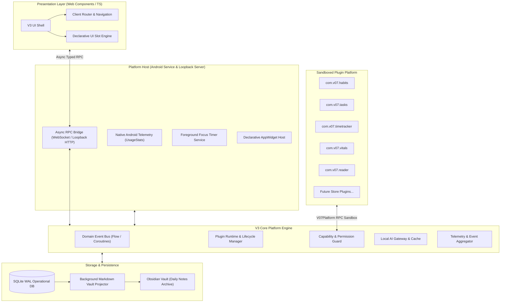

# V3 Target Architecture

## 1. Architectural Philosophy & Style

V3 follows a **Clean, Modular, Host-and-Plugin Architecture**:
- **Strict Separation of Concerns**: Core platform vs Platform Host vs Isolated Plugins.
- **Dependency Inversion**: High-level domain logic does not depend on low-level database drivers, Android SDK classes, or UI frameworks.
- **Single Source of Truth**: Persistent data is authored exclusively through an embedded transactional engine (SQLite with Write-Ahead Logging).
- **Asynchronous Event-Driven Communication**: Core and plugins interact via typed messages, domain events, and declarative extension points.

---

## 2. Module Boundaries & Dependency Rules

### Rule 1: Plugins Depend Only on Public Platform Contracts
- Plugins may import and call **only** the published `@v07/plugin-api` contract (`window.V07Platform`).
- Direct access to `window.parent`, Android native bridge classes, or other plugins' internal storage is strictly prohibited and structurally blocked by the sandbox.

### Rule 2: Core Platform Does Not Depend on Concrete Plugins
- The core platform contains zero plugin-specific business logic or UI code. Built-in plugins (`tasks`, `habits`, `vitals`, `timetracker`, `gamify`, `reader`, `chronosynth`) compile and ship as standard plugin packages adhering to the exact same contract as third-party extensions.

### Rule 3: Native Host Depends Inwardly on Core
- Android native features (UsageStats, Accessibility, AppWidgets, WindowManager overlays) implement clean abstract interfaces defined by Core (`TelemetryProvider`, `NotificationScheduler`, `WidgetRenderer`).

---

## 3. Data & Persistence Layer Architecture

### Primary Operational Engine: SQLite in WAL Mode (Schema Version 3)
- **Concurrency**: Write-Ahead Logging (WAL) enables concurrent readers without blocking writers. Multiple background collectors can ingest telemetry simultaneously with zero file-locking contention.
- **Core Schema**:
  - `events`: Legacy timeline events (`id`, `timestamp`, `category`, `value_num`, `text_payload`, `metadata_json`).
  - `sessions`: Focus & deep work sessions (`id`, `activity`, `start_time`, `end_time`, `elapsed_sec`, `notes`, `updated_at`).
  - `tasks`: Actionable tasks and milestones (`id`, `title`, `status`, `deadline`, `created_at`, `updated_at`).
  - `thoughts`: Stream of consciousness & brain dumps (`id`, `content`, `timestamp`, `date`, `updated_at`).
  - `app_usage`: Screen time telemetry sessions (`id`, `package_name`, `app_name`, `start_time`, `end_time`, `duration_ms`, `category`).
  - `plugin_events`: Structured domain event log partitioned by `plugin_id` and `category` (`id`, `plugin_id`, `category`, `payload_json`, `timestamp`, `date`).
  - `plugin_storage`: Isolated Key-value storage partitioned by `plugin_id`.
  - `sync_watermarks`: Collection-level high-water marks for delta sync (`collection_name`, `last_sync_timestamp`).
  - `recycle_bin`: Soft-delete quarantine with cascading restore/purge across all entity tables.
- **Indexes**: Indexed on `timestamp`, `category`, `date(timestamp)`, `plugin_id`, and `updated_at` for instantaneous multi-metric queries.

### Cloud Synchronization: 3-Tier Partitioned Firestore Architecture
- **Tier 1 (Core Platform Functions)**: Dedicated high-locality collections (`users/{uid}/sessions`, `users/{uid}/tasks`, `users/{uid}/thoughts`, `users/{uid}/appusage`, `users/{uid}/daytracker`).
- **Tier 2 (Sandboxed Plugin Utilities)**: Isolated KV storage (`users/{uid}/plugins/{pluginId}/storage`) and domain records (`users/{uid}/plugins/{pluginId}/events`).
- **Tier 3 (Sovereign System Ledger & Tombstones)**: Sovereign activity ledger (`users/{uid}/ledger`) and anti-resurrection deletion guards (`users/{uid}/tombstones`).
- **Dual-Read Non-Destructive Fallback**: Bi-directional sync queries partitioned collections first, seamlessly falling back to legacy `users/{uid}/events` when partitions are unpopulated, ensuring 100% zero-downtime rollback capability.

### Secondary Synchronization: Asynchronous Vault Projector
- To maintain compatibility with Obsidian, an asynchronous background service (`VaultSyncProjector`) observes SQLite write events.
- On day close or scheduled intervals, it exports clean, human-readable Markdown notes to `01 - Daily/YYYY-MM-DD.md` and append-only `.jsonl` audit streams.
- Operational queries **never** read from flat `.jsonl` files.

---

## 4. State Management & Event Bus

- **Authoritative Server State**: Active timers, day lifecycle state, and system metrics live inside the Core Service.
- **Reactive UI Flow**:
  - The client UI connects via a local WebSocket stream.
  - State changes in Core (e.g. `timer:tick`, `event:logged`, `day:transition`) are broadcast as typed JSON patches.
  - The UI updates reactively with zero DOM scraping or polling loops.

---

## 5. Security & Isolation Architecture

- **Authenticated Loopback Gateway**: The local HTTP/WebSocket server binds to `127.0.0.1` and requires a random session token generated at application boot.
- **Plugin Sandbox**: Plugins execute inside sandboxed Web Workers or sandboxed iframe environments with restricted origins (`sandbox="allow-scripts"`).
- **Capability-Based Permissions**: When a plugin requests an API action (e.g. `storage:write` or `events:listen`), the `SecurityManager` validates that the capability was declared in the plugin's manifest and granted by the user.
- **Secret Isolation**: AI credentials (Anthropic, Gemini, OpenAI) reside exclusively in encrypted local shared preferences and are never passed to the client web layer or exposed to plugins.
